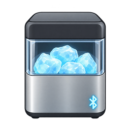

<p align="center"></p>

# Opal Local BLE

Local Home Assistant control for **first-generation GE / FirstBuild Bluetooth Opal ice makers**, through an HA Bluetooth adapter or active ESPHome proxy. No vendor app, account, cloud, MQTT, or dedicated ice-maker firmware.

**Experimental, version 0.2.0.** Pairing, night mode, ice-making control and bin-removed detection were user-confirmed on a first-generation GE Opal using 0.1.0. The new proxy selection/failover behavior needs live testing. This is not an official GE integration.

## HACS installation

1. Open **HACS → ⋮ → Custom repositories**.
2. Add `https://github.com/stewcloud/opal-local-ble`, category **Integration**.
3. Download **Opal Local BLE** and restart Home Assistant.
4. Add **Opal Local BLE** under Settings → Devices & services, or accept discovery.
5. Keep **Pair after connecting** enabled; it was required on the first tested GE unit.
6. Select Automatic or choose the nearby Bluetooth adapter/proxy explicitly.

Disable other Opal BLE integrations or dedicated Opal BLE clients before setup to avoid competing connections.

### Manual installation / upgrade

Copy `custom_components/opal_local` into `/config/custom_components/opal_local`, replacing the existing folder, and restart HA. Keep the integration entry; entity identities are unchanged. If you explicitly saved a polling interval, set it to 10 seconds in Configure.

Targets **HA 2026.10+**, including local bundled brand-image support. Older versions have not been tested. Reload the browser after restart if artwork is cached.

## Entities

| Entity | Meaning |
| --- | --- |
| Ice making | Starts/stops ice-making. Reads enable state when supported; otherwise infers only off/making states. Unknown while full, out of water, or cleaning if enable state is unavailable. |
| Night mode | Dim/night mode, not arbitrary brightness or separate lamp-off. |
| Status | Off, making ice, needs water, bin full, cleaning, unknown. |
| Bin removed | Bin position, not an ice-level measurement. |
| Needs water | Operating status is 2. |
| Cleaning phase | Raw phase number; interpretation needs validation. |
| Status code | Disabled-by-default raw diagnostic sensor. |

Status 3 is called bin full in the jdeath/ESPHome examples and idle in the BLE2MQTT example. Verify its meaning on your unit before relying on a full-bin automation. No weight or percentage-full measurement exists.

Only documented ice-making and night-mode boolean commands are written. No cleaning-start, reset, clock or hardware modification is performed. Use HA automations for schedules.

## Polling and Bluetooth proxies

Default polling is **10 seconds**, configurable from **5–600 seconds**. Transactions are serialized and disconnect afterwards to release proxy slots. Failed polls make entities unavailable; missing optional characteristics yield unknown.

Use current ESPHome firmware and enable active connections:

```yaml
bluetooth_proxy:
  active: true
```

The proxy must be connected to HA through ESPHome and in Bluetooth range of the Opal. Wi-Fi coverage alone is insufficient. Pairing support requires proxy firmware advertising the PAIRING feature (introduced in ESPHome 2024.3). No dedicated Opal ESPHome component is required.

- HA-managed BLE device objects retain local/remote backend routing.
- Automatic mode prefers HA's selected adapter when present, then other connectable candidates (up to three) if connection/pairing fails **before** an operation starts.
- Selecting a proxy pins the connection to that proxy. If it disappears, the integration does not silently switch bonding identity.
- Pairing is explicitly requested after connection. Successful pairing is remembered per source during this integration runtime, and retried after an authentication-related poll error or reload.
- Bonds belong to each adapter/proxy; a USB adapter's bond is not shared across all proxies.
- Commands request a status refresh. Failed writes are never replayed on another adapter.
- Passkey entry beyond the proxy's native pairing behavior is not implemented.

### First proxy test

After upgrading/restarting, open Opal Local BLE → Configure, choose the nearby proxy, keep pairing enabled, and set polling to 10 seconds. Check status/bin readings and test night mode and ice-making while observing the machine. Check recovery after disconnecting/reconnecting the proxy. Return to Automatic after individual proxy control is confirmed.

The new connection/pairing failover is tested with mocks, not hardware. A GATT application error may reflect appliance state or authentication; this integration does not blindly resend rejected commands.

## Diagnostics

Setup failures log their underlying cause. Check range, pairing, firmware, active connections, free proxy slots, and other connected apps.

```yaml
logger:
  logs:
    custom_components.opal_local: debug
```

Diagnostics exclude device addresses/names. HA logs may contain Bluetooth identifiers; redact them before posting publicly.

## Development

```sh
python -m unittest discover -s tests -p 'test_*.py' -v
python -m compileall -q custom_components
```

The 23 tests exercise actual protocol/coordinator code with minimal HA/transport stubs: decoding, cleanup, serialization, pairing, selected-proxy routing, automatic failover and no command replay. They do not validate the complete HA loader/config flow or physical BLE interoperability.

In the Windows build sandbox, `python tests/run_offline.py` uses a no-I/O loop because socketpair is unavailable. Never use that runner for real BLE.

## Acknowledgements

New implementation based on public protocol descriptions:

- https://github.com/jdeath/Opal_NuggetIce_ble — characteristic identifiers, discovery name, state mapping and ESPHome example.
- https://github.com/shmuelzon/esp32-ble2mqtt/wiki/Opal-(GE)-Ice-Maker — protocol and control examples.
- https://community.home-assistant.io/t/json-to-yaml-conversion-for-ge-opal/343192 — community ESPHome work.
- https://developers.home-assistant.io/docs/core/bluetooth/api/ — HA shared Bluetooth API.

Bundled icon is original generated artwork, not an official GE logo.

## Removal

Delete the integration entry, remove `/config/custom_components/opal_local`, and restart HA. Update or disable automations that reference its entities.
